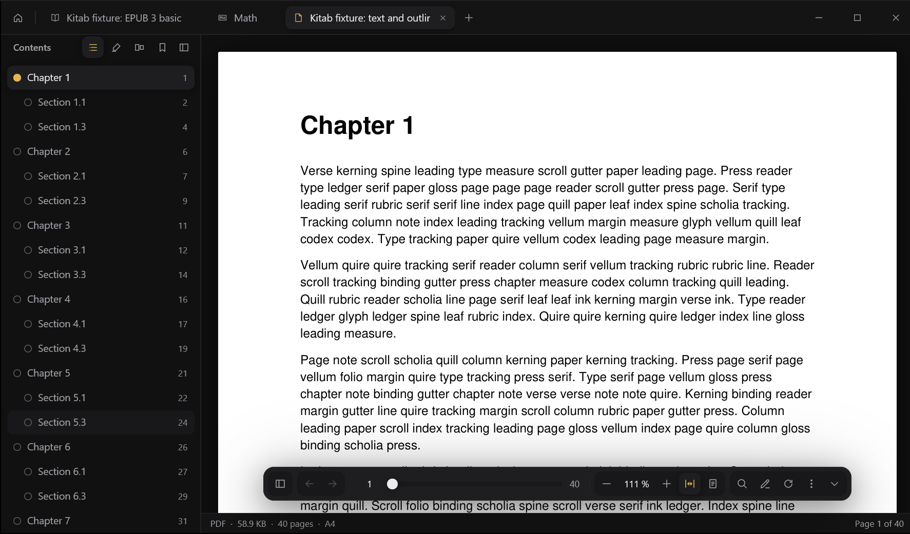
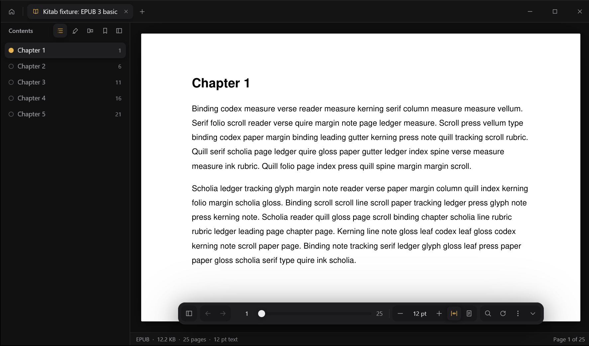
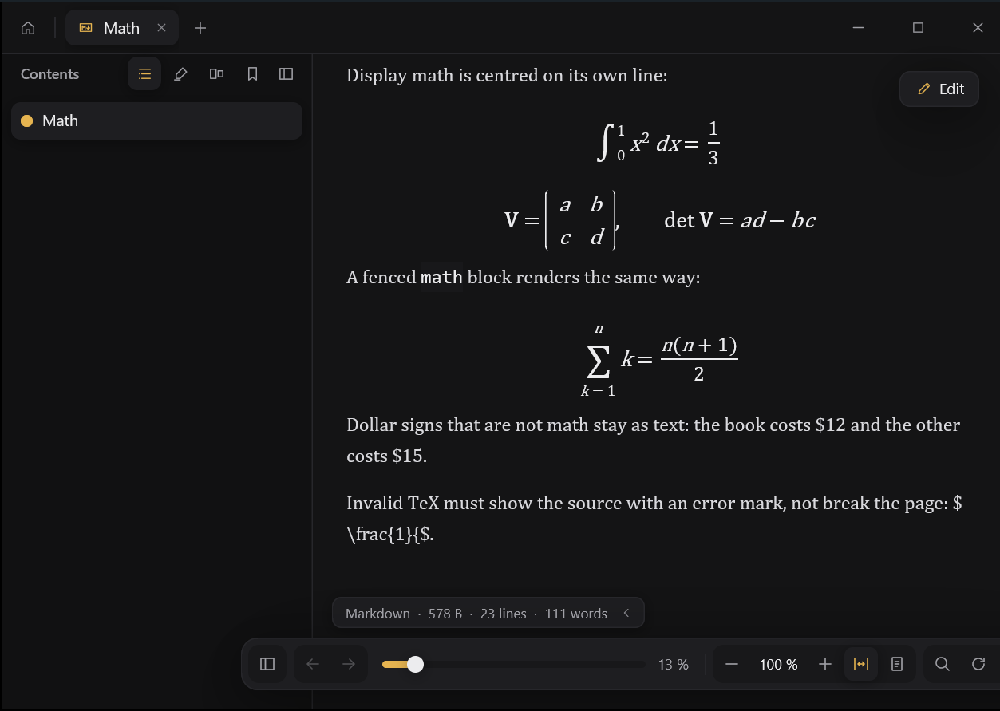
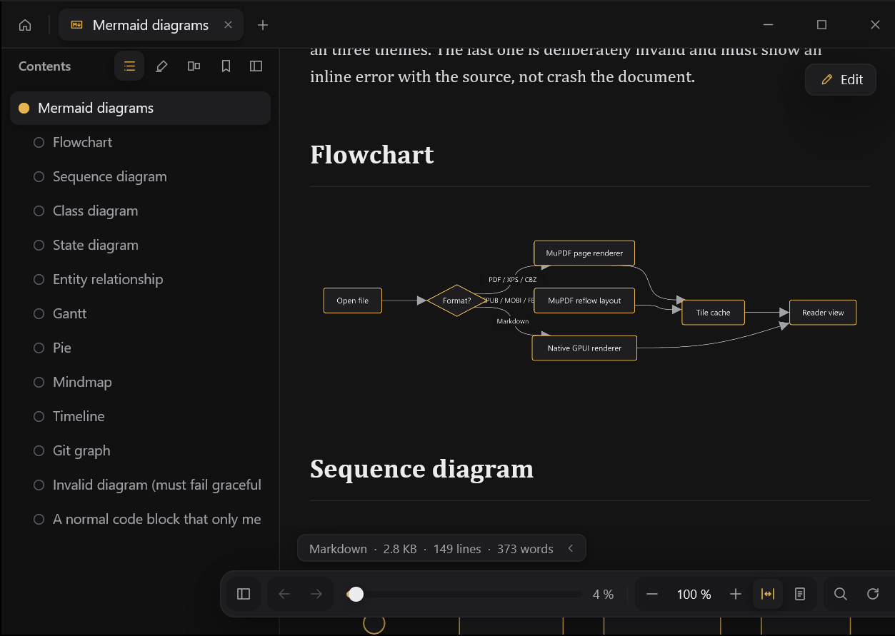
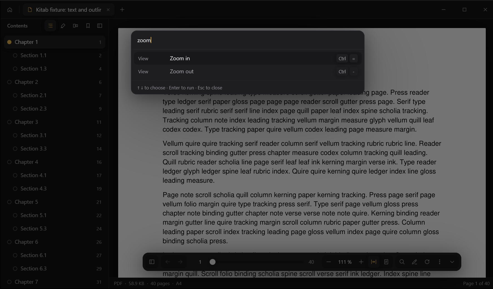
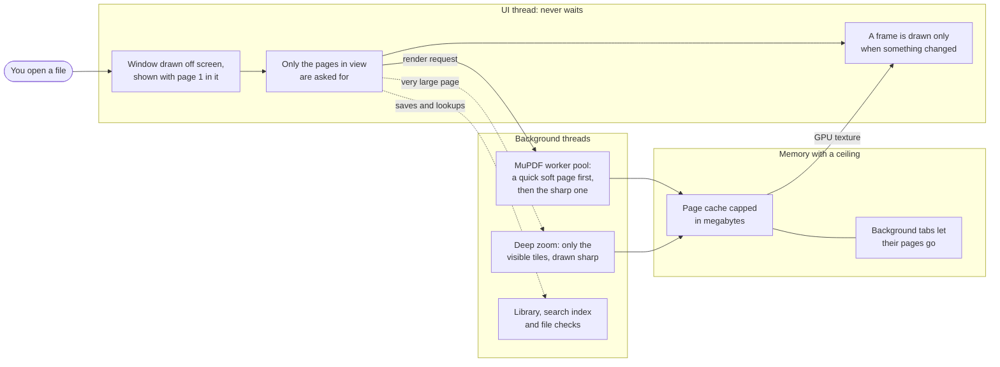
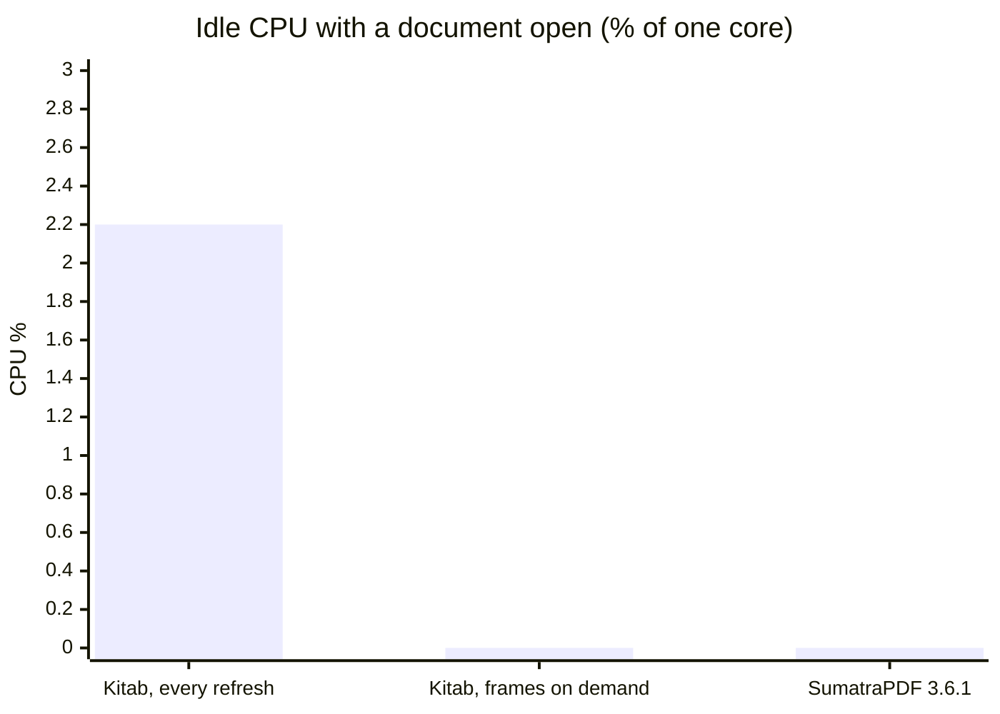

<div align="center">


# Kitab Reader

**Your library has a fast lane now.**

Rust underneath, a calm page on top. Kitab never makes you wait.

<sub>A desktop reader for PDF, books and Markdown, written in Rust and drawn on the GPU with GPUI. MuPDF renders the pages. There is no browser engine inside.</sub>

<br />

A **[t21 dev](https://github.com/t21dev)** project, by **[TriptoAfsin](https://github.com/TriptoAfsin)**, from the team behind [Turbo Reader](https://github.com/t21dev/turbo-reader).

[](LICENSE)
[](https://github.com/t21dev/kitab/releases/latest)


<br />

<a href="https://apps.microsoft.com/detail/9P530F6TRMQ1"></a>

</div>

---

## Download

**Windows:** the easiest way is the [Microsoft Store](https://apps.microsoft.com/detail/9P530F6TRMQ1). The Store build is signed, sets up file types and Explorer thumbnails, and updates itself.

<a href="https://apps.microsoft.com/detail/9P530F6TRMQ1"></a>

For every other system, or to install without the Store, get the latest version from [Releases](https://github.com/t21dev/kitab/releases/latest).

| System | Download |
|---|---|
| Windows 10 and 11 (Intel, AMD) | `Kitab_*_x64_setup.exe`, or `Kitab_*_x64_portable.zip` to run without installing |
| Windows on Arm | The x64 downloads, which Windows runs through its emulation |
| macOS, Apple silicon | `Kitab_*_aarch64.dmg` |
| macOS, Intel | `Kitab_*_x86_64.dmg` |
| Linux | `.flatpak`, `.AppImage`, `.deb`, `.rpm` or `.tar.gz` (x86_64; all but the Flatpak also for aarch64) |

Or install with a package manager:

```bash
# Windows, winget (installs the Microsoft Store build)
winget install 9P530F6TRMQ1 -s msstore

# macOS, Homebrew
brew install --cask t21dev/tap/kitab

# Windows, Scoop
scoop bucket add t21dev https://github.com/t21dev/scoop-bucket
scoop install t21dev/kitab
```

Or build and run it from the source with Cargo (see [Build from source](#build-from-source) for what you need first):

```bash
git clone https://github.com/t21dev/kitab
cd kitab
python tools/patch_gpui.py
cargo run --release -p kitab
```

**Unsigned builds.** The downloads on Releases aren't code-signed yet (the Microsoft Store build is). Every release lists the SHA-256 checksum of each file.

On Windows, SmartScreen may say "Windows protected your PC": choose More info, then Run anyway.

On macOS, the first launch may say Kitab "is damaged and can't be opened" or "cannot be verified". It isn't damaged: macOS says this about any app that isn't signed. After dragging Kitab to Applications, either:

- run this once in Terminal, then open Kitab as usual:

  ```bash
  xattr -cr /Applications/Kitab.app
  ```

- or, on macOS 15 (Sequoia) and later: try to open Kitab once, then go to System Settings › Privacy & Security, scroll to Security and click Open Anyway.
- or, on macOS 14 and earlier: right-click Kitab in Applications and choose Open, then Open again.

**Flatpak.** Install the bundle with `flatpak install --user Kitab_*_x86_64.flatpak`; Flatpak fetches the Freedesktop runtime from [Flathub](https://flathub.org/setup). Kitab can read and save files in your home folder and on external drives, and has no network access: Flatpak brings the updates. To make it the default app for PDFs, use your system's Default Applications settings.

**AppImage.** `chmod +x Kitab_*.AppImage` and run it. The `.deb`, `.rpm` and `.tar.gz` also install a thumbnailer, so file managers show page 1 of your documents.

## Screenshots



| Books, set in your typeface | Math in Markdown |
| --- | --- |
|  |  |

| Mermaid diagrams | Command palette |
| --- | --- |
|  |  |

---

## Why it is fast

Kitab is a native program. The window, the tabs and every page are drawn by [GPUI](https://github.com/zed-industries/zed/tree/main/crates/gpui), the GPU UI framework the Zed editor is built on, and the pages come from [MuPDF](https://mupdf.com/), the engine behind SumatraPDF. Nothing in between is a web page.



- **The page is in the window when it appears.** The window lays out and draws page 1 while hidden, then shows up with it. Update checks, keymaps, thumbnails and the library wait until after. With several tabs to restore, the one you were reading opens first and the rest follow.
- **The UI thread never waits.** Opening, rendering, searching, indexing and saving run on other threads. Several threads render one document's pages at once, and a quick soft render stands in while the sharp one draws.
- **Only what you can see.** Pages and thumbnails outside the view are skipped. A huge page (a map at 500 %) is drawn as a softer whole page with sharp tiles for just the part on screen.
- **Bounded memory.** The page cache is capped in megabytes, not pages, so memory stays the same however long the document is. Tabs in the background let their pages go.
- **Nothing runs while you read.** A frame is drawn only when something changed or an animation is playing, so an idle Kitab uses no CPU.

### Measured

Against SumatraPDF 3.6.1 on the same Windows 11 machine (Ryzen 9 9900X, RTX 5070), re-run for 0.6.0 on 15 November 2026: the 40-page `01-text-outline.pdf` in a 1200×800 window, timed from outside the app by [`kitab-bench`](crates/kitab-bench) and `tools/bench_reading.py`, each app in a fresh profile. The full runs are in [docs/perf/baseline.md](docs/perf/baseline.md).



| | Kitab 0.6.0 | SumatraPDF 3.6.1 |
|---|---|---|
| Window on screen | 241 ms, with the page already in it | 68 ms, blank at first |
| Page first seen | 268 ms | by 359 ms |
| CPU used to reach the page | 234 ms | 187 ms |
| CPU while idle | 0 % | 0 % |
| CPU while scrolling | about 8 % of one core | about 6 % |
| Private memory, one document | 103 MB (117 MB after scrolling) | 16 MB |

SumatraPDF starts sooner and is lighter: it draws with GDI, while Kitab first sets up the GPU (about 150 ms before its window exists), and about 88 MB of its memory is the GPU device, the graphics driver and DirectWrite, paid once whatever you open.

## What it opens

| Format | Notes |
| --- | --- |
| PDF | Password-protected files too. Links, contents, text selection, annotations already in the file |
| EPUB | Flowing and fixed-layout, right-to-left books, every script your system has fonts for |
| MOBI, FB2, TXT | Flow like EPUB, in your typeface and text size |
| CBZ, CBR, CB7 | Comics, page by page, whatever archive they're really in (WebP pages too). A plain ZIP, RAR or 7z of pictures opens the same way from inside Kitab |
| DjVu | Scanned books at their own page size; search, select and read aloud when the scan has a text layer; contents from its bookmarks |
| XPS | Pages at their own size |
| Markdown | Tables, task lists, footnotes, code with syntax colours, math, Mermaid diagrams, frontmatter |

Kitab is a document reader, so it leaves image files to your image viewer.

## Features

**Reading**
- Each page keeps its own size and shape, so mixed portrait and landscape PDFs look right
- Fit width, fit page, actual size, Ctrl+wheel zoom and rotation; choose how new documents open
- One page across, two side by side, or a book's spreads with the cover alone (Ctrl+6, Ctrl+7, Ctrl+8)
- Page colour: the document's own, dark pages, or your theme's paper and ink
- Smooth scrolling with the mouse wheel and the keys (it can be turned off)
- Touch screens on Windows: drag to scroll, pinch to zoom
- Remembers the page, zoom and layout of every file, and reopens your tabs after a restart (or starts on Home, or the last file)
- Find (Ctrl+F) with match case and whole word, hits highlighted on the page
- Read aloud (Ctrl+Shift+U) with your system's voices, Markdown too. The dock's speaker opens play, pause, a sentence back or on, and the speed, tone and voice, which change as it reads. The word being read is marked and the pages follow (or stay put)
- Contents (with folding sections), page thumbnails, bookmarks (Ctrl+D) and your marks, all in the sidebar; search the contents and bookmarks as you type
- A PDF's own page labels (i, ii, 1, 2…) in the page box, status bar and contents, and Go to page takes them
- Unsaved form fields and Markdown edits survive a crash: Kitab offers them back when it opens
- PDFs reload by themselves when another program changes them
- Back and forward through where you've been, with Alt+Left and the mouse's side buttons
- Presentation mode (F5): one page at a time, full screen on black; type a page number to jump, B or W to blank the screen
- Focus mode (F11) hides everything but the page; Esc brings it all back

**Books**
- Pages re-flow to fill the window, and zoom changes the text size
- Typeface (the book's own, serif, sans or mono), line spacing and margins
- Right-to-left books turn the other way, and fixed-layout books keep their spreads
- Comics can read right to left, for manga

**Markdown**
- Reads like a document, not a code file, with an outline in the sidebar
- Math typeset natively, Mermaid diagrams drawn in your theme's colours
- Edit beside a live preview (Ctrl+E), and it reloads when another editor saves the file
- Choose the typeface for code

**Marks and notes**
- Highlight, underline or strike through text, add notes and text boxes
- Pen, highlighter, lines, arrows, rectangles and ellipses, in any colour you can type as hex
- Ctrl+S saves marks into the PDF as standard annotations, which other readers show too, or save a copy with them and leave the original as it is
- Fill in PDF forms: checkboxes, radio buttons, lists and text fields, with undo
- Export your marks to Markdown or CSV

**Library**
- Home shows your books as covers or a list, on shelves: Recent, All, Favourites, In progress, Finished and your own collections
- Watched folders bring in every document they hold; + From folder makes a collection of one folder's documents
- At the end of a book, go on to the next file in its folder
- Library search finds words inside every document you've opened, and books by title, author or file name
- Reading stats: time read today and this week, your streak, and a bar per day
- Remove a book from Home, or Locate… one that moved (its place, bookmarks and marks follow it)

**PDF tools, on your machine**
- Print (Ctrl+P) through the system's own print dialog: all pages, this page or a range, fit to paper or actual size
- Sign PDFs with a certificate file (.pfx, .p12), and see signatures checked when a PDF opens
- Page tools: delete, move or turn pages, compress, add page numbers or a watermark
- Save pages as a new PDF, merge PDFs, save a page as PDF, image or text
- Split view: two documents side by side

**Keyboard and look**
- SumatraPDF's shortcuts where it has one, and a `keymap.json` for your own
- A command palette (Ctrl+K) that finds commands, open tabs, recent files and headings
- Ten themes (Dark, Gray, Light, Paper, Sand, Linen, Ink, Nord, Noctua, Vampire), any accent colour, three densities; it can follow the system's light and dark mode
- A quick dock you can move to any edge, choose the buttons of, or tuck away
- An optional menu bar (File, Edit, View, Go, Tools, Help) with Alt-key access, off until you turn it on; on macOS the same menus are in the system menu bar

**Windows**
- One window: double-clicking another file opens it as a tab
- Page thumbnails in File Explorer, and Settings to make Kitab the default app per file type

**Coming next:** an accessibility pass for screen readers, a short first-run tour, and code-signed downloads. The [roadmap](docs/PLAN.md#12-roadmap) has the order.

## Privacy

Your files stay on your computer, and there is no account, no analytics and no telemetry. Kitab connects to one service on its own: GitHub, shortly after start-up and every six hours, to ask for the latest version number. Settings › About turns that off. Links you click open in your browser. The details are in [PRIVACY.md](PRIVACY.md).

## Build from source

You need Rust stable (see `rust-toolchain.toml`), Python 3, and libclang for the MuPDF bindings (install LLVM and, if the build can't find it, set `LIBCLANG_PATH` to the folder that holds `libclang`). On Windows you also need the Visual Studio C++ build tools.

```powershell
git clone https://github.com/t21dev/kitab
cd kitab
python tools/patch_gpui.py       # once: makes vendor/gpui-0.2.2, the patched GPUI the workspace builds against
cargo run -p kitab -- tests\fixtures\pdf\01-text-outline.pdf
cargo test --workspace
cargo clippy --workspace --all-targets -- -D warnings
python tools/check_source.py     # licence headers, no colour literals outside kitab-theme
cargo deny check
```

Release packages: `python tools/build_release.py`, then `python tools/package.py <version>` (an installer, portable zip, dmg, or on Linux the .tar.gz, .deb, .rpm and .AppImage). The Flatpak builds offline from `packaging/flatpak/dev.t21.kitab.yml`; its header lists the steps.

The tests read a corpus of PDF, EPUB and Markdown fixtures with an `expected.json` oracle. To rebuild it:

```powershell
python -m venv tests\fixtures\tools\.venv
tests\fixtures\tools\.venv\Scripts\pip install -r tests\fixtures\tools\requirements.txt
tests\fixtures\tools\.venv\Scripts\python tests\fixtures\tools\generate_fixtures.py --large
tests\fixtures\tools\.venv\Scripts\python tests\fixtures\tools\verify_fixtures.py
```

## Repository

```
crates/
  kitab          the app: start-up, first frame, adapters
  kitab-ui       GPUI views: shell, tabs, reader, sidebar, settings
  kitab-mupdf    MuPDF on a pool of worker threads
  kitab-md       Markdown parsing, sanitising, highlighting, math
  kitab-store    the library database (SQLite), forward-only migrations
  kitab-theme    colour tokens and the themes
  kitab-os       Windows, macOS and Linux glue: data folder, file types, single instance
  kitab-shell    the File Explorer thumbnail provider
  kitab-bench    start-up and scroll benchmarks against SumatraPDF
docs/PLAN.md     decisions, architecture, performance budgets, roadmap
docs/perf/       benchmark runs against SumatraPDF
DESIGN.md        the design system: tokens, depth, type, components, motion
```

## Contributing

Commits follow [Conventional Commits](https://www.conventionalcommits.org/), every user-visible change adds a line to [CHANGELOG.md](CHANGELOG.md), and a bug fix comes with a test that fails without it.

## Support

This project is free and open source. If it saves you time, you can support [Team 21](https://t21.dev) on [Patreon](https://www.patreon.com/triptex). It pays for code signing, app store fees and servers. In Bangladesh? You can support in taka on [SupportKori](https://www.supportkori.com/triptex).

## Licence

Kitab is free software under the [GNU AGPL 3.0 or later](LICENSE).

Built on [MuPDF](https://mupdf.com/) by Artifex (AGPL), [GPUI](https://github.com/zed-industries/zed/tree/main/crates/gpui) by Zed Industries, [pulldown-cmark](https://github.com/pulldown-cmark/pulldown-cmark), [syntect](https://github.com/trishume/syntect), [mermaid-svg](https://github.com/xmiksay/mermaid) and [resvg](https://github.com/linebender/resvg). The Nord theme's colours come from [Nord](https://www.nordtheme.com/). The full list is in [NOTICE](NOTICE).

Kitab Reader is made by [t21 dev](https://github.com/t21dev) and [TriptoAfsin](https://github.com/TriptoAfsin).
