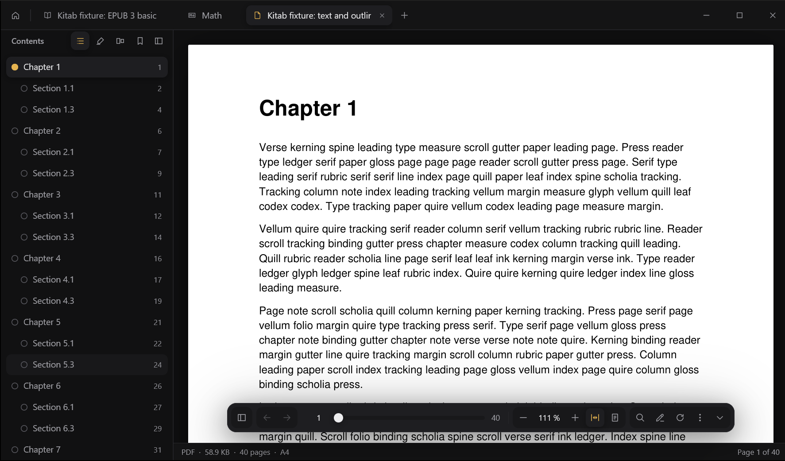
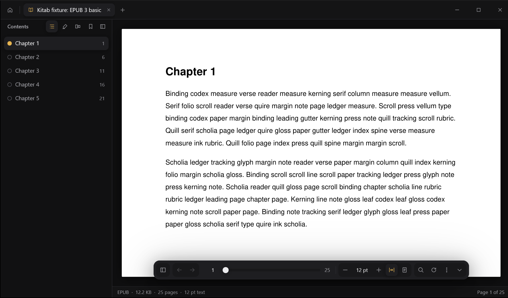
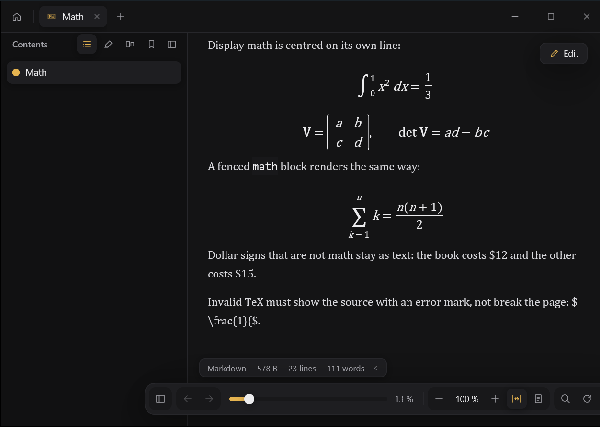
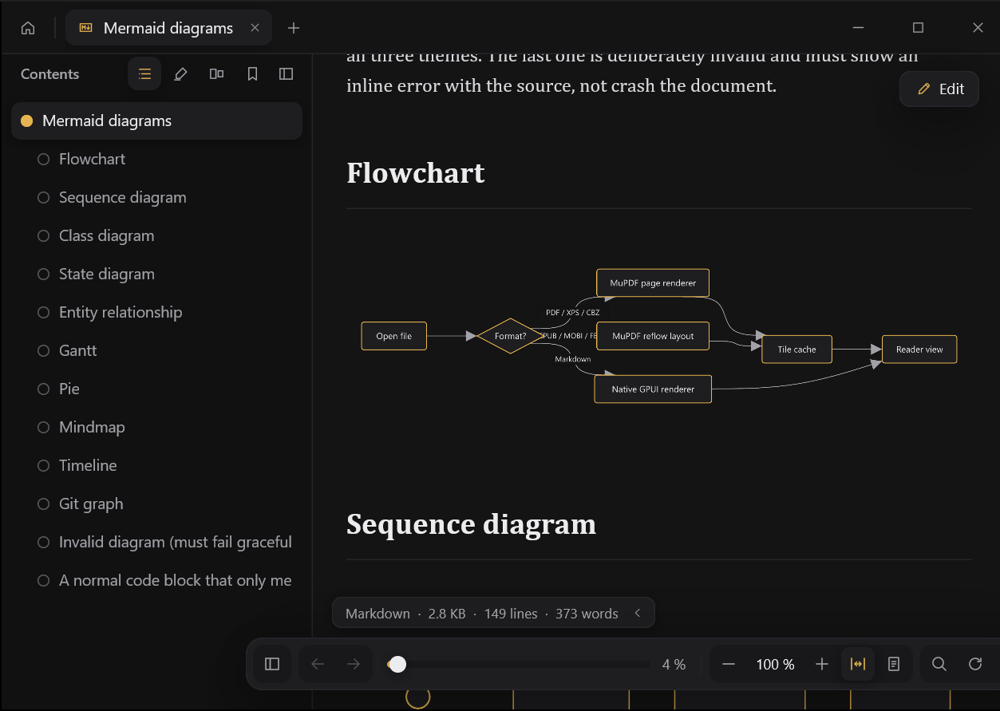
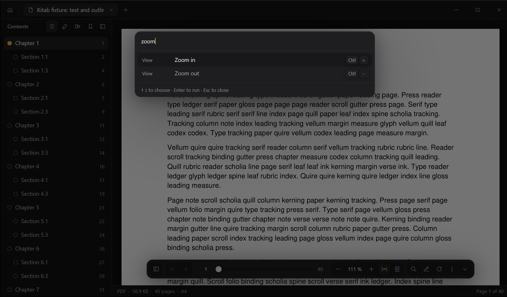

<div align="center">


# Kitab Reader

**Your library has a fast lane now.**

Rust underneath, a calm page on top. Kitab never makes you wait.

<sub>A desktop reader for PDF, books and Markdown, written in Rust and drawn on the GPU with GPUI. MuPDF renders the pages. There is no browser engine inside.</sub>

<br />

A **[t21 dev](https://github.com/t21dev)** project, by **[TriptoAfsin](https://github.com/TriptoAfsin)**, from the team behind [Turbo Reader](https://github.com/t21dev/turbo-reader).

[](LICENSE)
[](https://github.com/t21dev/kitab/releases/latest)


<br />

<a href="https://apps.microsoft.com/detail/9P530F6TRMQ1"></a>

</div>

---

## Download

**Windows:** the easiest way is the [Microsoft Store](https://apps.microsoft.com/detail/9P530F6TRMQ1). The Store build is signed, sets up file types and Explorer thumbnails, and updates itself.

<a href="https://apps.microsoft.com/detail/9P530F6TRMQ1"></a>

For every other system, or to install without the Store, get the latest version from [Releases](https://github.com/t21dev/kitab/releases/latest).

| System | Download |
|---|---|
| Windows 10 and 11 (Intel, AMD) | `Kitab_*_x64_setup.exe`, or `Kitab_*_x64_portable.zip` to run without installing |
| Windows on Arm | The x64 downloads, which Windows runs through its emulation |
| macOS, Apple silicon | `Kitab_*_aarch64.dmg` |
| macOS, Intel | `Kitab_*_x86_64.dmg` |
| Linux | `.flatpak`, `.AppImage`, `.deb`, `.rpm` or `.tar.gz` (x86_64; all but the Flatpak also for aarch64) |

Or install with a package manager:

```bash
# Windows, winget (installs the Microsoft Store build)
winget install 9P530F6TRMQ1 -s msstore

# macOS, Homebrew
brew install --cask t21dev/tap/kitab

# Windows, Scoop
scoop bucket add t21dev https://github.com/t21dev/scoop-bucket
scoop install t21dev/kitab
```

Or build and run it from the source with Cargo (see [Build from source](#build-from-source) for what you need first):

```bash
git clone https://github.com/t21dev/kitab
cd kitab
python tools/patch_gpui.py
cargo run --release -p kitab
```

**Unsigned builds.** The downloads on Releases aren't code-signed yet (the Microsoft Store build is). Every release lists the SHA-256 checksum of each file.

On Windows, SmartScreen may say "Windows protected your PC": choose More info, then Run anyway.

On macOS, the first launch may say Kitab "is damaged and can't be opened" or "cannot be verified". It isn't damaged: macOS says this about any app that isn't signed. After dragging Kitab to Applications, either:

- run this once in Terminal, then open Kitab as usual:

  ```bash
  xattr -cr /Applications/Kitab.app
  ```

- or, on macOS 15 (Sequoia) and later: try to open Kitab once, then go to System Settings › Privacy & Security, scroll to Security and click Open Anyway.
- or, on macOS 14 and earlier: right-click Kitab in Applications and choose Open, then Open again.

**Flatpak.** Install the bundle with `flatpak install --user Kitab_*_x86_64.flatpak`; Flatpak fetches the Freedesktop runtime from [Flathub](https://flathub.org/setup). Kitab can read and save files in your home folder and on external drives, and has no network access: Flatpak brings the updates. To make it the default app for PDFs, use your system's Default Applications settings.

**AppImage.** `chmod +x Kitab_*.AppImage` and run it. The `.deb`, `.rpm` and `.tar.gz` also install a thumbnailer, so file managers show page 1 of your documents.

## Screenshots



| Books, set in your typeface | Math in Markdown |
| --- | --- |
|  |  |

| Mermaid diagrams | Command palette |
| --- | --- |
|  |  |

---

## Why it is fast

Kitab is a native program. The window, the tabs and every page are drawn by [GPUI](https://github.com/zed-industries/zed/tree/main/crates/gpui), the GPU UI framework the Zed editor is built on, and the pages come from [MuPDF](https://mupdf.com/), the engine behind SumatraPDF. Nothing in between is a web page.

The speed comes from a few rules the code is held to ([AGENTS.md](AGENTS.md)):

- **Nothing extra before the first page.** On Windows the first page is painted with plain GDI while the GPU window starts up behind it, so a double-clicked PDF shows its page straight away. Update checks, keymaps, thumbnails and the library wait until after.
- **The UI thread never waits.** Opening, rendering, searching and saving run on a pool of MuPDF workers. Several threads render one document's pages at once, and a quick soft render stands in while the sharp one draws.
- **Only what you can see.** Pages and thumbnails outside the view are skipped, and the page cache is capped in bytes, not pages, so memory stays bounded however long the document is.
- **Measured against SumatraPDF.** `kitab-bench` times start-up, first page, scrolling and memory against SumatraPDF on the same machine, from the app's own window. The 0.1.0 numbers will be published with the release, measured, not estimated.

## What it opens

| Format | Notes |
| --- | --- |
| PDF | Password-protected files too. Links, contents, text selection, annotations already in the file |
| EPUB | Flowing and fixed-layout, right-to-left books, every script your system has fonts for |
| MOBI, FB2, TXT | Flow like EPUB, in your typeface and text size |
| CBZ | Comics, page by page |
| XPS | Pages at their own size |
| Markdown | Tables, task lists, footnotes, code with syntax colours, math, Mermaid diagrams, frontmatter |

Kitab is a document reader, so it leaves image files to your image viewer.

## Features

**Reading**
- Each page keeps its own size and shape, so mixed portrait and landscape PDFs look right
- Fit width, fit page, actual size, Ctrl+wheel zoom and rotation
- Remembers the page, zoom and layout of every file, and reopens your tabs after a restart
- Find (Ctrl+F) with match case and whole word, hits highlighted on the page
- Contents, page thumbnails, bookmarks (Ctrl+D) and your marks, all in the sidebar
- Back and forward through where you've been, with Alt+Left and the mouse's side buttons
- Presentation mode (F5): one page at a time, full screen on black
- Minimal mode (F11) hides everything but the page

**Books**
- Pages re-flow to fill the window, and zoom changes the text size
- Typeface (the book's own, serif, sans or mono), line spacing and margins
- Right-to-left books turn the other way, and fixed-layout books keep their spreads

**Markdown**
- Reads like a document, not a code file, with an outline in the sidebar
- Math typeset natively, Mermaid diagrams drawn in your theme's colours
- Edit beside a live preview (Ctrl+E), and it reloads when another editor saves the file

**Marks and notes**
- Highlight, underline or strike through text, add notes and text boxes
- Pen, highlighter, lines, arrows, rectangles and ellipses, in any colour you can type as hex
- Ctrl+S saves marks into the PDF as standard annotations, which other readers show too
- Export your marks to Markdown or CSV

**PDF tools, on your machine**
- Save pages as a new PDF, merge PDFs, save a page as PDF, image or text
- Split view: two documents side by side

**Keyboard and look**
- SumatraPDF's shortcuts where it has one, a command palette (Ctrl+K), and a `keymap.json` for your own
- Seven themes (Dark, Light, Paper, Ink, Nord, Noctua, Vampire), any accent colour, three densities
- A quick dock you can move to any edge, choose the buttons of, or tuck away

**Windows**
- One window: double-clicking another file opens it as a tab
- Page thumbnails in File Explorer, and Settings to make Kitab the default app per file type

**Coming next:** native printing, verifying and signing PDFs, more page tools, and library search. The [roadmap](docs/PLAN.md#12-roadmap) has the order.

## Privacy

Your files stay on your computer, and there is no account, no analytics and no telemetry. Kitab connects to one service on its own: GitHub, shortly after start-up and every six hours, to ask for the latest version number. Settings › About turns that off. Links you click open in your browser. The details are in [PRIVACY.md](PRIVACY.md).

## Build from source

You need Rust stable (see `rust-toolchain.toml`), Python 3, and libclang for the MuPDF bindings (install LLVM and, if the build can't find it, set `LIBCLANG_PATH` to the folder that holds `libclang`). On Windows you also need the Visual Studio C++ build tools.

```powershell
git clone https://github.com/t21dev/kitab
cd kitab
python tools/patch_gpui.py       # once: makes vendor/gpui-0.2.2, the patched GPUI the workspace builds against
cargo run -p kitab -- tests\fixtures\pdf\01-text-outline.pdf
cargo test --workspace
cargo clippy --workspace --all-targets -- -D warnings
python tools/check_source.py     # licence headers, no colour literals outside kitab-theme
cargo deny check
```

Release packages: `python tools/build_release.py`, then `python tools/package.py <version>` (an installer, portable zip, dmg, or on Linux the .tar.gz, .deb, .rpm and .AppImage). The Flatpak builds offline from `packaging/flatpak/dev.t21.kitab.yml`; its header lists the steps.

The tests read a corpus of PDF, EPUB and Markdown fixtures with an `expected.json` oracle. To rebuild it:

```powershell
python -m venv tests\fixtures\tools\.venv
tests\fixtures\tools\.venv\Scripts\pip install -r tests\fixtures\tools\requirements.txt
tests\fixtures\tools\.venv\Scripts\python tests\fixtures\tools\generate_fixtures.py --large
tests\fixtures\tools\.venv\Scripts\python tests\fixtures\tools\verify_fixtures.py
```

## Repository

```
crates/
  kitab          the app: start-up, first frame, adapters
  kitab-ui       GPUI views: shell, tabs, reader, sidebar, settings
  kitab-mupdf    MuPDF on a pool of worker threads
  kitab-md       Markdown parsing, sanitising, highlighting, math
  kitab-store    the library database (SQLite), forward-only migrations
  kitab-theme    colour tokens and the themes
  kitab-os       Windows, macOS and Linux glue: data folder, file types, single instance
  kitab-shell    the File Explorer thumbnail provider
  kitab-bench    start-up and scroll benchmarks against SumatraPDF
docs/PLAN.md     decisions, architecture, performance budgets, roadmap
DESIGN.md        the design system: tokens, depth, type, components, motion
AGENTS.md        rules for changing the code
```

## Contributing

Read [AGENTS.md](AGENTS.md) first. Commits follow [Conventional Commits](https://www.conventionalcommits.org/), every user-visible change adds a line to [CHANGELOG.md](CHANGELOG.md), and a bug fix comes with a test that fails without it.

## Licence

Kitab is free software under the [GNU AGPL 3.0 or later](LICENSE).

Built on [MuPDF](https://mupdf.com/) by Artifex (AGPL), [GPUI](https://github.com/zed-industries/zed/tree/main/crates/gpui) by Zed Industries, [pulldown-cmark](https://github.com/pulldown-cmark/pulldown-cmark), [syntect](https://github.com/trishume/syntect), [mermaid-svg](https://github.com/xmiksay/mermaid) and [resvg](https://github.com/linebender/resvg). The Nord theme's colours come from [Nord](https://www.nordtheme.com/). The full list is in [NOTICE](NOTICE).

Kitab Reader is made by [t21 dev](https://github.com/t21dev) and [TriptoAfsin](https://github.com/TriptoAfsin).
