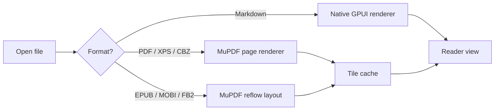
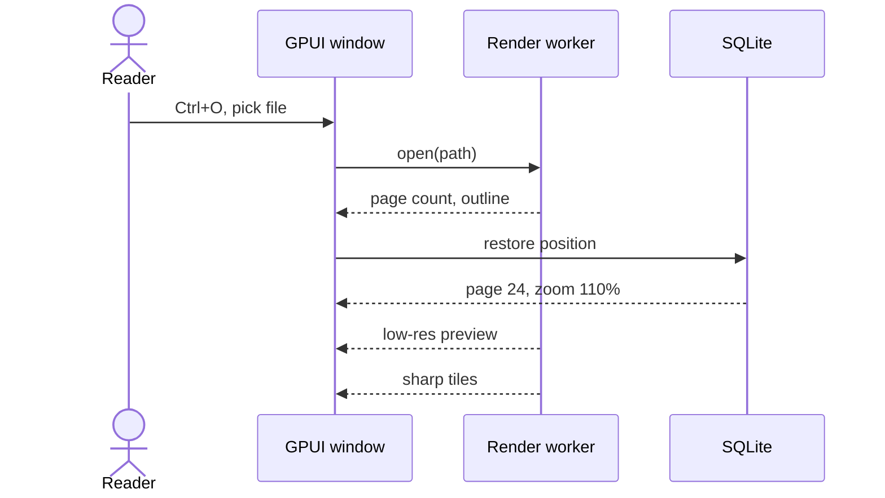
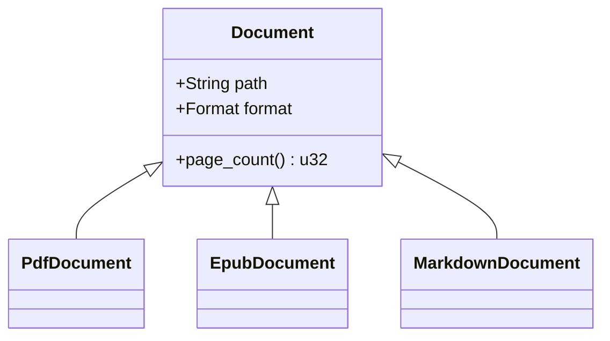
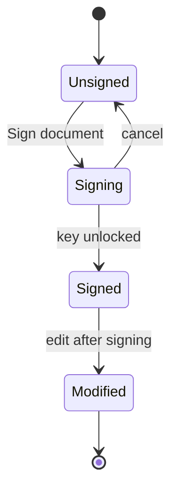
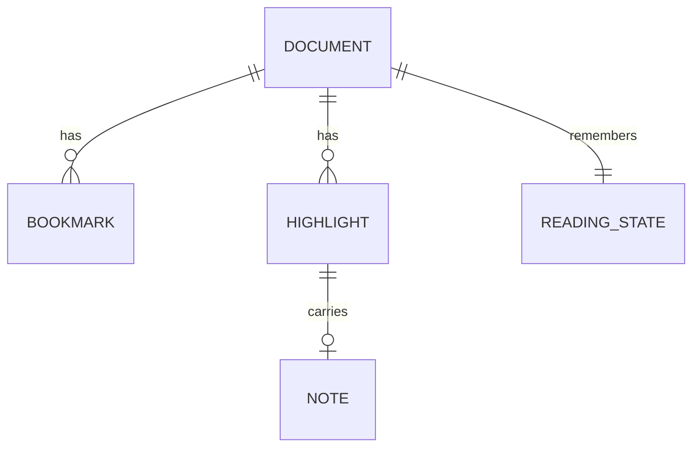
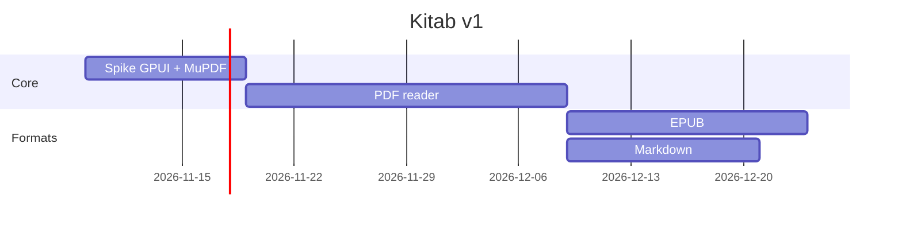
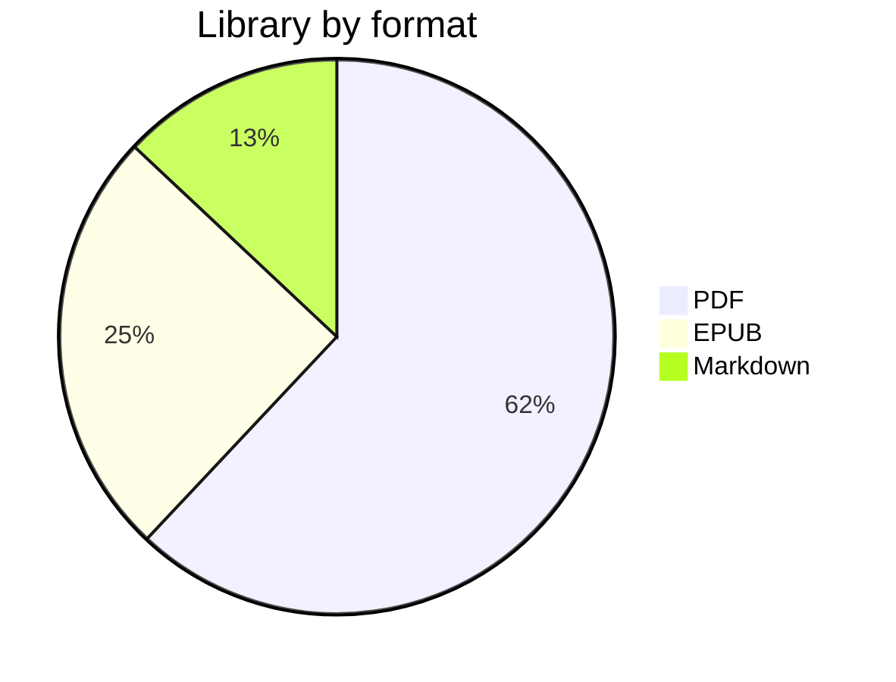
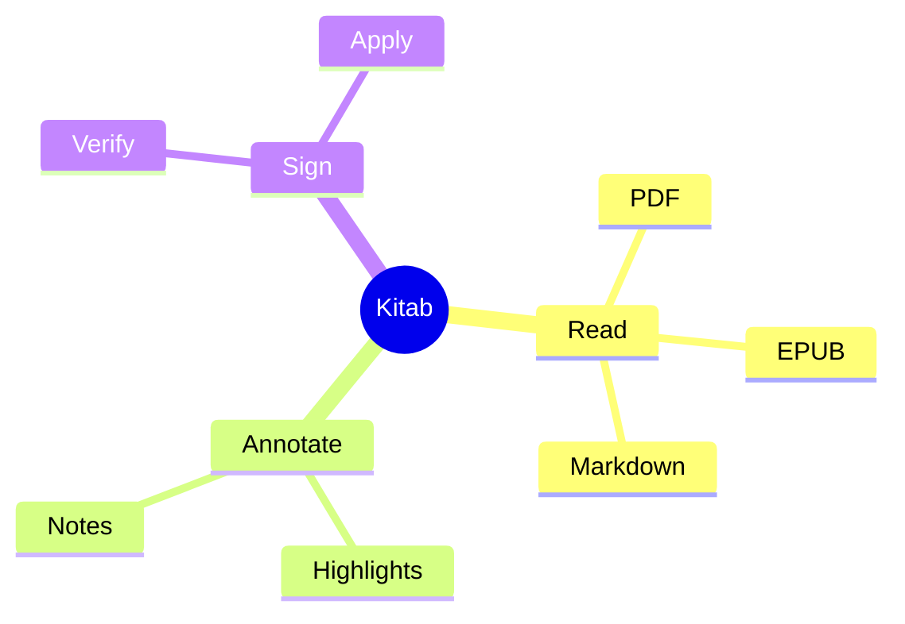
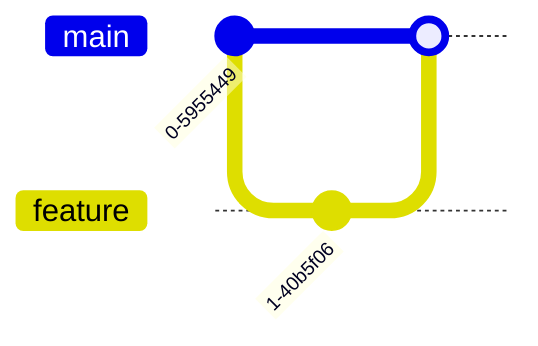

# Mermaid diagrams

Every block below is a ` ```mermaid ` fence. Each must render as a diagram in all three themes. The last one is deliberately invalid and must show an inline error with the source, not crash the document.

## Flowchart



## Sequence diagram



## Class diagram



## State diagram



## Entity relationship



## Gantt



## Pie



## Mindmap



## Timeline

```mermaid
timeline
    title Reading session
    09:00 : Opened Meditations
    09:20 : Highlighted Book II
    09:45 : Exported highlights
```

## Git graph



## Invalid diagram (must fail gracefully)

```mermaid
flowchart LR
    A --> 
    this is not valid mermaid ((((
```

## A normal code block that only mentions mermaid

```text
mermaid is not the language of this block, so it stays plain text
```
